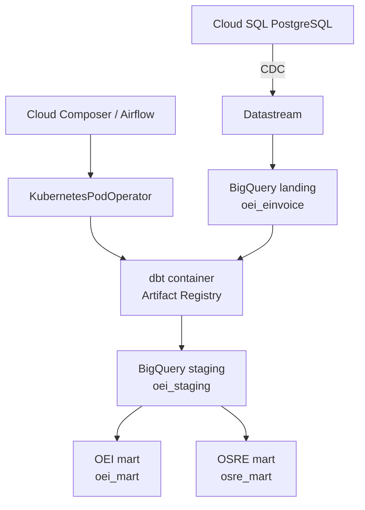

# OEI dbt Data Platform Lab

A cloud-native data platform lab that replicates operational PostgreSQL data into BigQuery, transforms it with dbt, and orchestrates the transformation pipeline with Apache Airflow on Google Cloud Composer.

The infrastructure and deployment workflows are managed through Pulumi and GitHub Actions without long-lived Google Cloud credentials.

## Architecture



## Data flow

1. Cloud SQL hosts the source PostgreSQL database.
2. Datastream replicates changes from `public.orders` into BigQuery.
3. The landing table is stored as `oei_einvoice.public_orders`.
4. dbt creates the staging view `oei_staging.stg_orders`.
5. dbt creates the OEI mart table `oei_mart.orders`.
6. dbt creates the OSRE reconciliation table `osre_mart.order_reconciliation_feed`.
7. Airflow runs the staging build before the mart build.
8. dbt tests stop the pipeline if staging validation fails.

## Repository structure

| Path | Purpose |
| --- | --- |
| `dags/` | Airflow DAG definitions |
| `models/staging/` | dbt staging models and tests |
| `models/marts/` | OEI and OSRE mart models |
| `tests/` | Custom dbt data tests |
| `macros/` | dbt schema naming logic |
| `profiles/` | dbt BigQuery connection profile |
| `infrastructure/deploy/` | Persistent Pulumi infrastructure |
| `infrastructure/runtime/` | Operational and ephemeral Pulumi resources |
| `.github/workflows/` | Validation, image publishing, preview, and deployment workflows |
| `Dockerfile` | Reproducible dbt runtime image |

## Infrastructure stacks

### Deploy stack

The deploy stack manages long-lived platform resources:

- BigQuery datasets
- Cloud SQL
- Artifact Registry
- Google Cloud APIs
- Service accounts and IAM
- GitHub Workload Identity Federation
- GitHub preview, deployment, and image publishing identities

### Runtime stack

The runtime stack manages operational resources:

- Datastream connection profiles
- Datastream replication stream
- Optional Cloud Composer environment

Composer is controlled by:

```yaml
oei-platform-runtime:composerEnabled: "true"
```

or:

```yaml
oei-platform-runtime:composerEnabled: "false"
```

Composer cannot be paused. Disabling it through Pulumi deletes the environment to control lab costs.

## Airflow pipeline

The DAG `oei_dbt_pipeline` runs two tasks:

1. `dbt_build_staging`
2. `dbt_build_marts`

The dependency is:

```python
dbt_build_staging >> dbt_build_marts
```

The tasks run the pinned dbt container through `KubernetesPodOperator`.

## GitHub Actions

| Workflow | Trigger | Purpose |
| --- | --- | --- |
| `PR validation` | Pull request | Validate Python, Pulumi, dbt, and Airflow |
| `Pulumi preview` | Pull request | Preview deploy and runtime infrastructure changes |
| `Publish dbt image` | Push or manual | Build and publish the dbt container |
| `Pulumi deployment` | Manual | Apply the deploy or runtime stack from `main` |

Deployments require:

- The `main` branch
- A manual workflow dispatch
- The exact confirmation value `APPLY`
- GitHub Workload Identity Federation
- The dedicated deployment service account

No long-lived Google Cloud service account key is stored in GitHub.

## Composer DAG deployment

After a successful runtime deployment, the workflow:

1. Checks whether Composer exists.
2. Skips DAG deployment safely when Composer is disabled.
3. Requires the environment to be `RUNNING`.
4. Finds tracked Python files under `dags/`.
5. Uploads them to the Composer DAG bucket.
6. Lists the deployed DAG files.

## Manual deployment

Deploy the persistent stack:

```bash
gh workflow run pulumi-deploy.yml \
  --ref main \
  -f target=deploy \
  -f confirmation=APPLY
```

Deploy the runtime stack:

```bash
gh workflow run pulumi-deploy.yml \
  --ref main \
  -f target=runtime \
  -f confirmation=APPLY
```

Infrastructure configuration changes must first pass through a branch, pull request, CI validation, and merge into `main`.

## Validation performed

The lab has successfully demonstrated:

- PostgreSQL to BigQuery CDC replication
- dbt staging and mart transformations
- dbt schema and custom data tests
- Containerized dbt execution
- Airflow DAG parsing
- Successful Airflow execution of both dbt tasks
- Three matching rows across landing, staging, OEI mart, and OSRE mart
- Pulumi creation and deletion of Composer
- Automated Composer DAG deployment
- Safe workflow behavior when Composer is absent
- GitHub Actions authentication through Workload Identity Federation

## Cost control

When the lab is not in use:

- Cloud SQL is stopped with activation policy `NEVER`.
- Datastream is paused.
- Composer is deleted by setting `composerEnabled` to `false` and deploying the runtime stack.
- Persistent resources such as BigQuery storage and Artifact Registry remain available.

The deploy stack remains intact so that the environment can be recreated without rebuilding the platform identity and IAM foundation.

## Development workflow

Changes follow this process:

1. Synchronize `main`.
2. Create a dedicated branch.
3. Make one scoped change.
4. Run local validation and Pulumi previews.
5. Stage only the intended files.
6. Commit and push the branch.
7. Create a draft pull request.
8. Wait for all CI checks.
9. Mark the pull request ready.
10. Squash-merge into `main`.
11. Manually authorize deployment when infrastructure must change.
12. Verify the live Google Cloud state.
